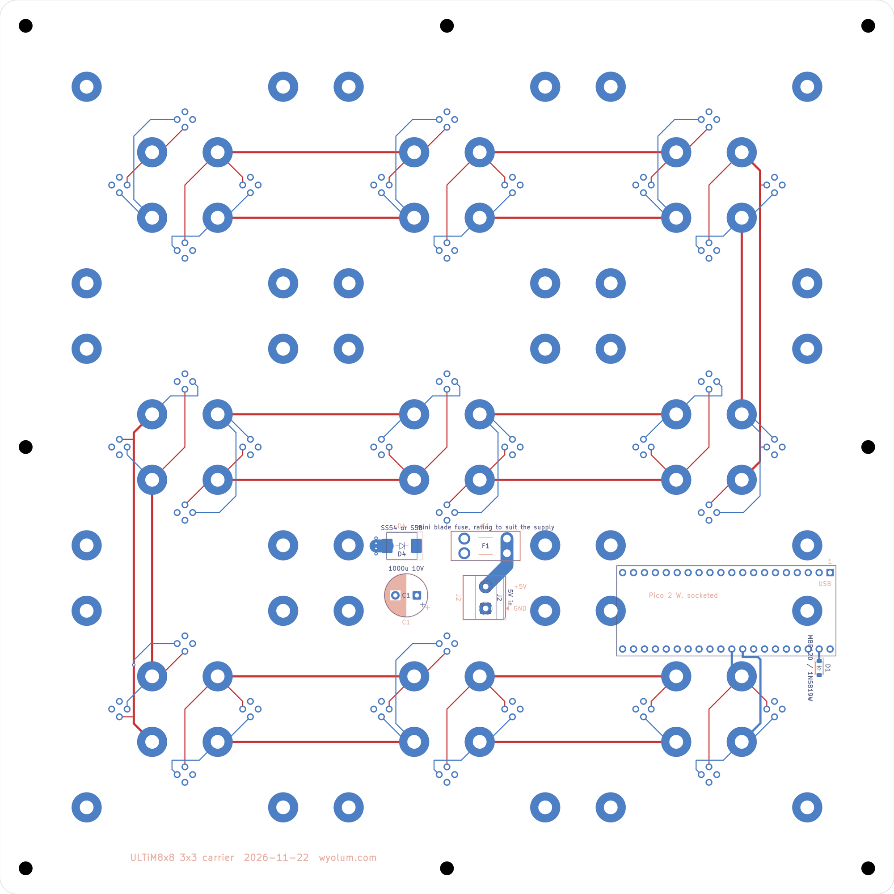
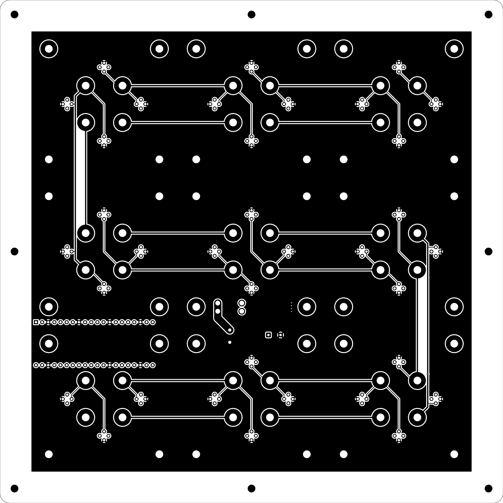
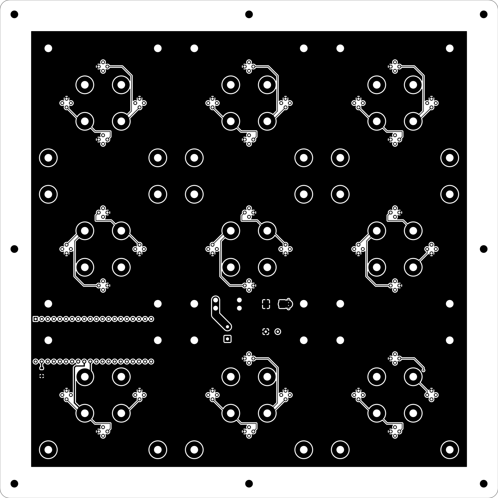
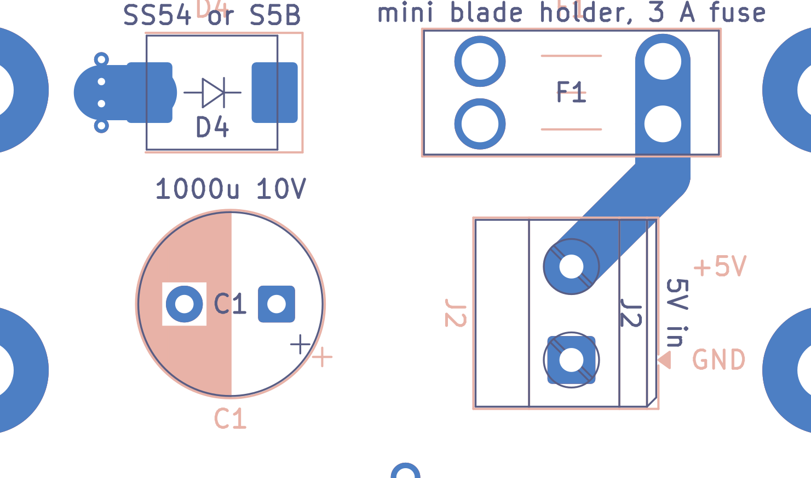
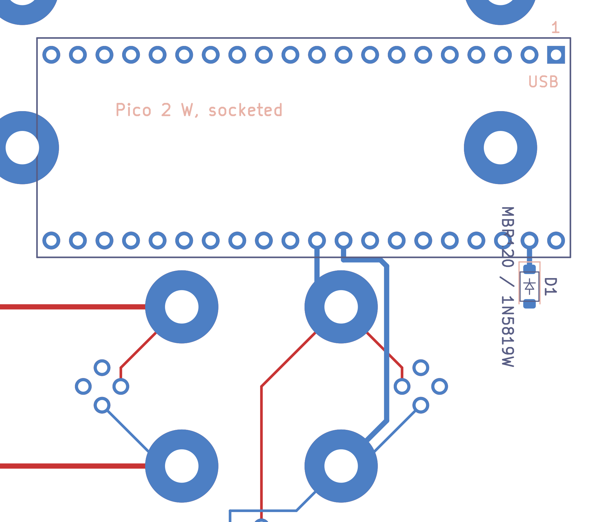
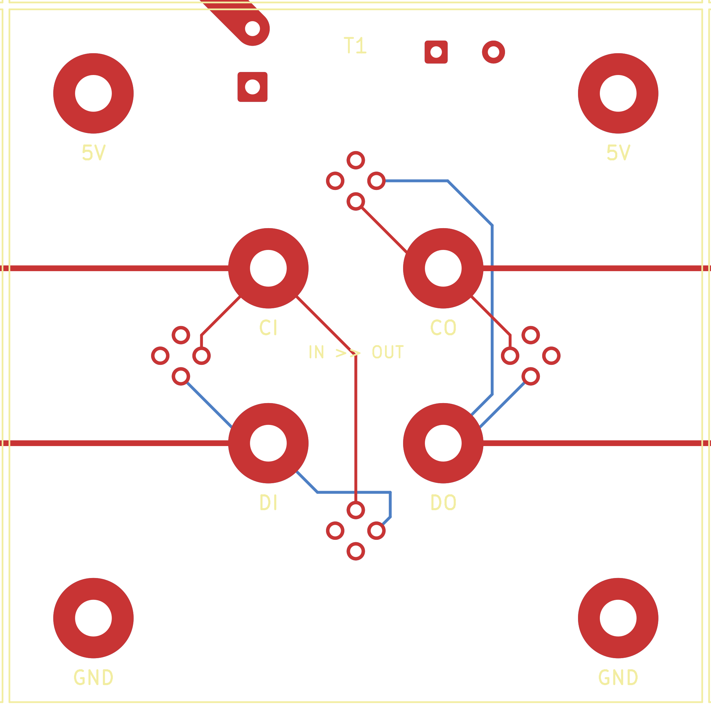

# ULTiM8x8 3x3 carrier board

A 208 x 208 mm, 2-layer backplane that holds nine [ULTiM8x8](https://github.com/wyolum/ultim8x8) APA102 tiles in a 3 x 3 grid (576 LEDs). The tiles bolt to it on M3 standoffs, and the standoffs carry 5 V, GND, clock and data. A Raspberry Pi Pico 2 W plugs into the back and drives the first tile directly.

**Status: draft for review, simplified 2026-11-22. Not fabricated. Please do not order from this yet.**

Anool, this README is meant to be everything you need. There are six things to check, each with a picture: the [review checklist](#review-checklist).

## Read this first

1. **The board came first, not a schematic.** A Python script, `2026-11-21_build_carrier.py`, places every pad and track and assigns the nets. The [schematic](docs/2026-11-22_schematic.pdf) is drawn afterwards from the saved board, so it always agrees with the board and cannot catch a wrong net. KiCad's DRC passes with 0 violations and 0 unconnected pads ([report](docs/2026-11-22_drc_report.txt)), which proves the copper matches the nets the script assigned, not that those nets are right.
2. **The script and this README were written by an AI assistant (Claude) working with Justin.** "I" below is the assistant. Nobody who knows KiCad well has looked at the result.
3. **The .kicad_pcb is generated output.** Edits made in KiCad are overwritten the next time the script runs. If you would rather fix things by hand, say so and the script gets retired.

An earlier version of this repo also had an Arduino UNO header, an AlaMode header, a level shifter and a clock/data bus between them. All of that is gone. It is in the git history if it is ever wanted.

## The whole circuit

| Net | Connects |
|---|---|
| `VIN` | J2 pin 2, F1 pin 1 |
| `+5V` | F1 pin 2, D4 cathode, C1 +, D1 anode, every tile 5V hole. B.Cu pour. |
| `GND` | J2 pin 1, D4 anode, C1 -, Pico pins 3, 8, 13, 18, 23, 28, 38, every tile GND hole. F.Cu pour. |
| `VSYS` | D1 cathode, Pico pin 39 |
| `CLK0` | Pico pin 31 (GP26, SPI1 SCK), tile T0 clock in |
| `DAT0` | Pico pin 32 (GP27, SPI1 TX), tile T0 data in |
| `CLK1` to `CLK8`, `DAT1` to `DAT8` | Tile n-1 out to tile n in |
| `CLK9`, `DAT9` | T8 outputs, unconnected |

The Pico drives the first tile at 3.3 V with no level shifter. Each diamond header pin is on the same net as the matching tile terminal.

| Ref | Part | Footprint |
|---|---|---|
| J2 | 2-pin screw terminal, 5.08 mm | Phoenix MKDS 1,5/2-5.08 |
| F1 | Mini blade fuse holder, Keystone 3568, with a 3 A mini blade fuse | library |
| D4 | 5 A diode, SS54 or S5B | SMC |
| C1 | 1000 uF 10 V electrolytic, under 20 mm tall | Radial D10 P5 |
| D1 | 1 A Schottky, MBR120 or 1N5819W | SOD-123 |
| A1 | Pico 2 W on two 1x20 sockets | drawn in script |
| T0 to T8 | Tile terminals, 8 plated M3 holes each | drawn in script |
| T*n*In1, In2, Out1, Out2 | 2x2 pin header turned 45 degrees, optional, for v2 tiles | drawn in script |

## How the pictures are oriented

- **LED-side view** means looking at the finished box from the front, through the tiles. The front copper (F.Cu) faces the tiles.
- **Back view** means the board as you hold it to solder the parts. It is the LED-side view mirrored left to right.
- In the color pictures the pours are hidden so the traces show: **red is F.Cu, blue is B.Cu**.
- Coordinates are millimeters from the board center, x right and y up in the LED-side view.



*Back view. Supply parts at center, Pico at right, both below the middle. Signal enters at tile T0 (lower right here), runs along the bottom row, back along the middle row, then along the top row. The middle row of tiles is mounted turned 180 degrees so the hops between rows stay short.*

## Review checklist

### 1. Tile terminal holes and nets

The tiles Justin has are an older revision with 8 terminal holes: an outer square at +/-22.86 mm (5V on the two top corners, GND on the two bottom) and an inner square at +/-7.62 mm (clock in, clock out, data in, data out). The v2 layout in the ultim8x8 repo has 16 holes; these 8 are a subset with the same nets, so the board should fit both.


*The tile in hand, seen from the back. Flip it left to right to compare with the LED-side pictures.*


*Every tile pad read back from the saved board, LED-side view. Arrows join a tile's outputs to the next tile's inputs.*

Please check:
- Hole positions and nets against a real tile or the tile layout. A first, 3D-printed version of this backplane was scrapped because it was routed for the 16-hole tile.
- Pad size: 3.2 mm hole, 7.0 mm pad on both sides, to seat a 5.5 mm hex standoff on the front and a screw head on the back.
- Whether a plated M3 hole with a standoff and screw is a sound way to carry up to about 3.8 A per tile at full white.

### 2. Power pours



*F.Cu, filled, LED-side view: GND pour plus the clock and data traces.*



*B.Cu, filled, seen through from the LED side: +5V pour.*

Please check:
- **Pour pullback.** Both pours stop 1 mm inside the 184 mm frame opening, leaving 13 mm of bare board around the edge. The frame wall and the eight perimeter screws sit there, and the corner screws run through to metal standoffs at the front of the box.
- **Solid pad connections.** Tile power pads, J2 and F1 connect to the pours without thermal spokes, since they carry current and the tile pads are never soldered. Other soldered pads use spokes 0.6 mm wide with a 0.4 mm gap.
- Pour clearance is 0.4 mm. The eight perimeter holes are unplated, 3.2 mm.

### 3. Tile-to-tile signal traces


*Front, LED-side view, right-hand side: the hop from the bottom row up to the middle row.*

Clock and data run on F.Cu, 0.5 mm wide. Along a row each hop is a straight 45.7 mm trace. At a row turn both hops share one column of holes, so the longer one steps 4.27 mm outward around the other's pads, in the 1.5 mm gap between the tile pads and the inner pin of the diamond headers.

Please check:
- Whether 0.5 mm traces across a ground pour are reasonable for APA102 clock and data, and whether you would add series resistors.
- The stepped trace runs about 0.6 mm from the tile pads on one side and the diamond pins on the other.

### 4. Supply entry, fuse and reverse-polarity diode



*Back view. J2 pin 1 (square) is GND, the other is the supply. C1's square pad is +. The wide trace from J2 to F1 is on both layers.*

The supply goes J2 to F1 to the +5V pour. D4 sits across the supply after the fuse, cathode on +5V, so a reversed supply forward-biases it and blows the fuse. These parts sit in a square between tiles T1 and T4 that has no tile pad, screw head or diamond header.

Please check:
- J2 and C1 polarity.
- The J2 to F1 trace: 3 mm wide on both layers, about 12 mm long. Full white on 576 LEDs is nominally 34 A, which this entry cannot carry; the box runs far below that, limited in firmware. The chosen setting, a warm white (R 255, G 190, B 120) at global brightness 1/31, works out to about 155 mA per tile (calculated from 20 mA per color at full scale, not measured), so about 1.4 A for nine tiles.
- D4 as a crowbar. It has to survive long enough to blow whatever fuse is fitted. Four 0.4 mm vias take its anode to the ground pour.
- Fuse rating: 3 A, about twice the 1.4 A running current. Please say if the J2 to F1 trace or D4 looks wrong for that.

### 5. Pico 2 W



*Back view. USB end of the Pico is at the right, pin 1 at the square pad. Tile T0's four signal terminals and two of its diamond headers are below.*

Clock is GP26 (pin 31) and data is GP27 (pin 32), the hardware SPI1 pair. They were chosen because they are the two Pico pins nearest T0's inputs: the clock trace drops 4 mm straight into the clock terminal, and the data trace steps around that pad and runs 20 mm down to the data terminal. Both are 0.5 mm on B.Cu.

Please check:
- **Pico pin numbering and orientation.** The Pico's top faces away from the board. Pins 1 to 20 are the upper row in this picture, from the USB end; pins 40 down to 21 are the lower row, from the USB end.
- **D1 direction:** anode on +5V, cathode on VSYS (pin 39), so a USB cable cannot power the LED rail.
- **3.3 V drive.** No level shifter. A 5 V APA102 nominally wants 3.5 V for a high, so this is 0.2 V under spec on paper. Breadboard test, 2026-11-22: one tile at 5 V driven straight from a Pico 2 W on these two pins, hardware SPI1 at 1 MHz, frames resent 20 times a second, showed clean steady color. That is one tile on one bench, not a guarantee for every tile. Only the first LED of T0 sees the 3.3 V signal; every LED after it gets a regenerated 5 V signal.
- Mechanical: the Pico sits over two tile screw heads, which is why it goes on sockets and is not soldered flat.

### 6. Diamond headers for v2 tiles



*Front, LED-side view of tile T1. The small pads along the top edge belong to the supply parts on the back.*

The v2 tile has four 2x2 pin headers turned 45 degrees, 15.24 mm from the tile center. The carrier has matching pads so a v2 tile can connect through pin headers as well as through its standoffs. Positions and pin roles were read from `ultim_8x8_v2/ultim8x8.kicad_pcb`, LED-side view, tile not turned:

| Header | Center (mm) | Inner pin | Outer pin | Other two |
|---|---|---|---|---|
| In1 | (-15.24, 0) | clock in | GND | 5V above, data in below |
| Out2 | (+15.24, 0) | clock out | GND | 5V above, data out below |
| Out1 | (0, +15.24) | clock out | GND | 5V left, data out right |
| In2 | (0, -15.24) | clock in | GND | 5V left, data in right |

35 of the 36 are placed. T0 Out1 is left out because the Pico's pin row crosses it; T0 still has In1, In2 and Out2. Clock pins route to the tile's clock terminal on F.Cu and data pins to the data terminal on B.Cu.

Please check:
- **The pin roles.** I worked them out from the pad positions and the 45 degree footprint rotations in the v2 file. A sign error in that rotation would swap pins. The result is at least self-consistent: facing headers on neighboring tiles line up 5V to 5V and data to data.
- **Stack height.** The tiles sit on 10 mm standoffs. A standard pin header and socket stack to about 11 mm.
- Whether these are worth having on a board whose standoffs already carry every signal. They are the most intricate routing on the board and are easy to remove.

## Schematic and fab files

The [schematic](docs/2026-11-22_schematic.pdf) ([image](docs/2026-11-22_schematic.png)) has no wires: every pin carries a label, and pins with the same label are on the same net. I exported its netlist with `kicad-cli` and compared it with the board pin by pin: 232 connected pins, 24 nets, no differences. Opening it in KiCad gives one library warning per symbol, because the symbols exist only inside the sheet.

`fab/` has Gerbers and drill files (also zipped), a BOM, a position file and an IPC-D-356 netlist, so you can look at the board in a Gerber viewer. The "do not order" at the top still stands.

## Files

| File | What it is |
|---|---|
| `ultim_carrier.kicad_pcb`, `.kicad_pro`, `.kicad_sch` | Board (pours filled), project and schematic, KiCad 10.0.3 |
| `2026-11-21_build_carrier.py` | Board generator. All dimensions and nets are near the top. |
| `2026-11-21_build_schematic.py` | Draws the schematic from the saved board |
| `2026-11-21_export_fab.py` | Writes everything in `fab/` |
| `2026-11-21_plot_carrier.py`, `2026-11-21_render_docs.py` | Draw the pictures in `docs/` |

To rebuild from scratch on macOS with KiCad 10:

```bash
KP=/Applications/KiCad/KiCad.app/Contents/Frameworks/Python.framework/Versions/Current/bin/python3
KC=/Applications/KiCad/KiCad.app/Contents/MacOS/kicad-cli
$KP 2026-11-21_build_carrier.py ultim_carrier.kicad_pcb pads.json
$KC pcb drc --refill-zones --save-board --severity-all -o docs/2026-11-22_drc_report.txt ultim_carrier.kicad_pcb
python3 2026-11-21_plot_carrier.py pads.json docs/2026-11-22_tile_nets.png
python3 2026-11-21_render_docs.py
python3 2026-11-21_build_schematic.py pads.json ultim_carrier.kicad_sch
$KC sch export pdf -o docs/2026-11-22_schematic.pdf ultim_carrier.kicad_sch
python3 2026-11-21_export_fab.py
```

The script saves the pours unfilled, because filling zones from KiCad 10's Python crashes without a GUI. The `drc --refill-zones --save-board` step fills them.

## Things that are not done

- The schematic is derived from the board. Nobody has drawn the circuit independently.
- The Gerbers have not been through a fab's checker.
- The enclosure is being redesigned around this board and has not been checked against it in 3D.

## License

[CERN Open Hardware Licence v1.2](LICENSE), the same licence as [ULTiM8x8](https://github.com/wyolum/ultim8x8).
