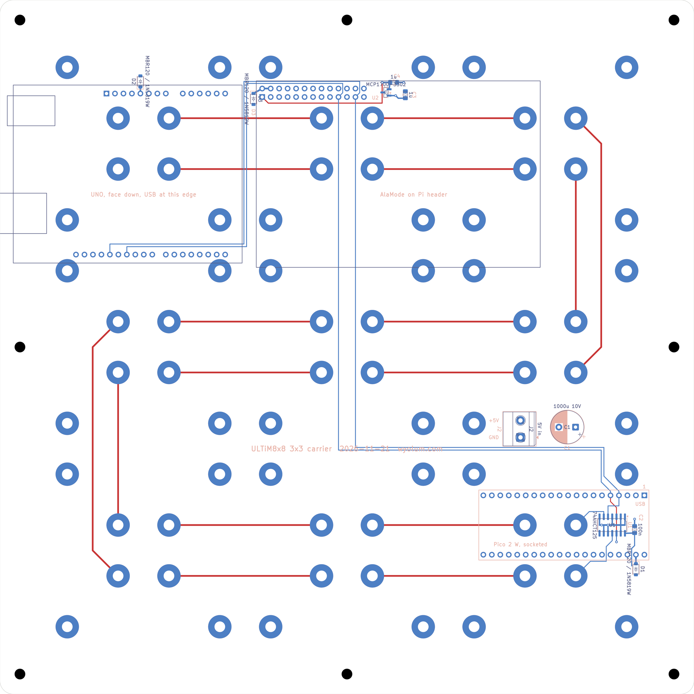
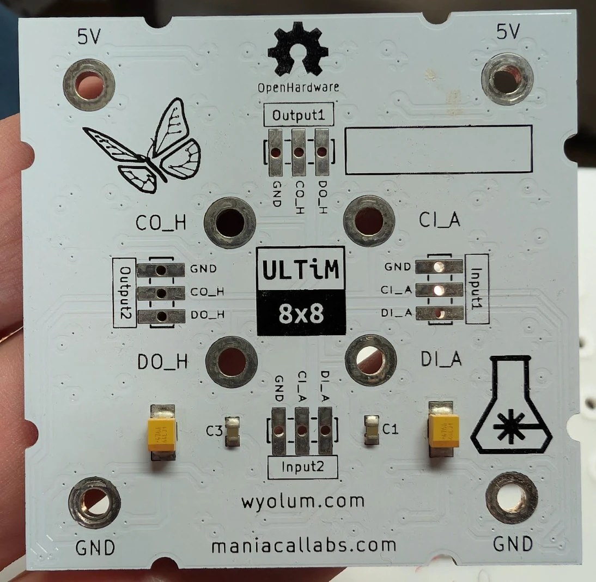
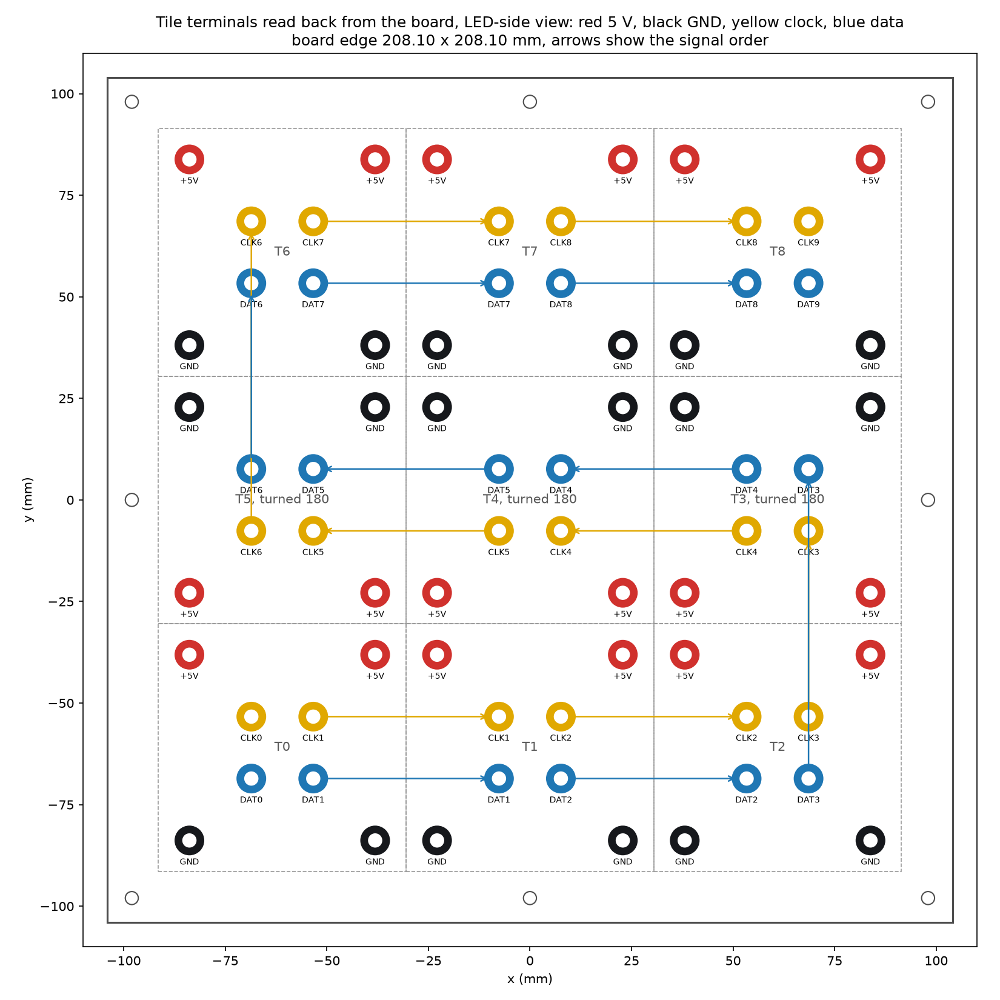
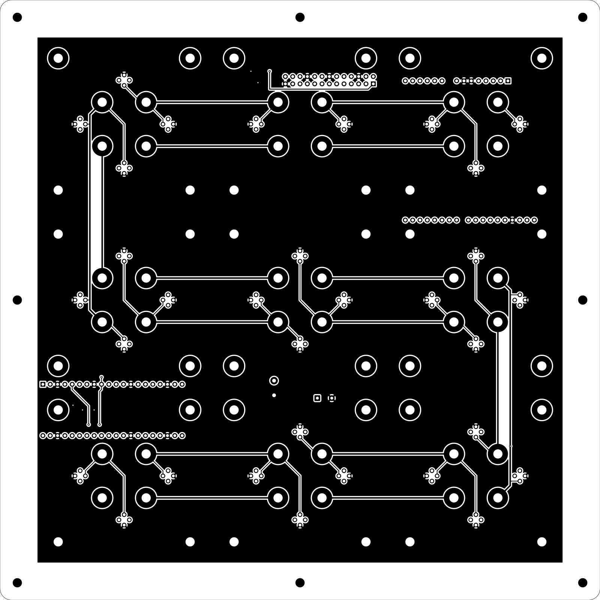
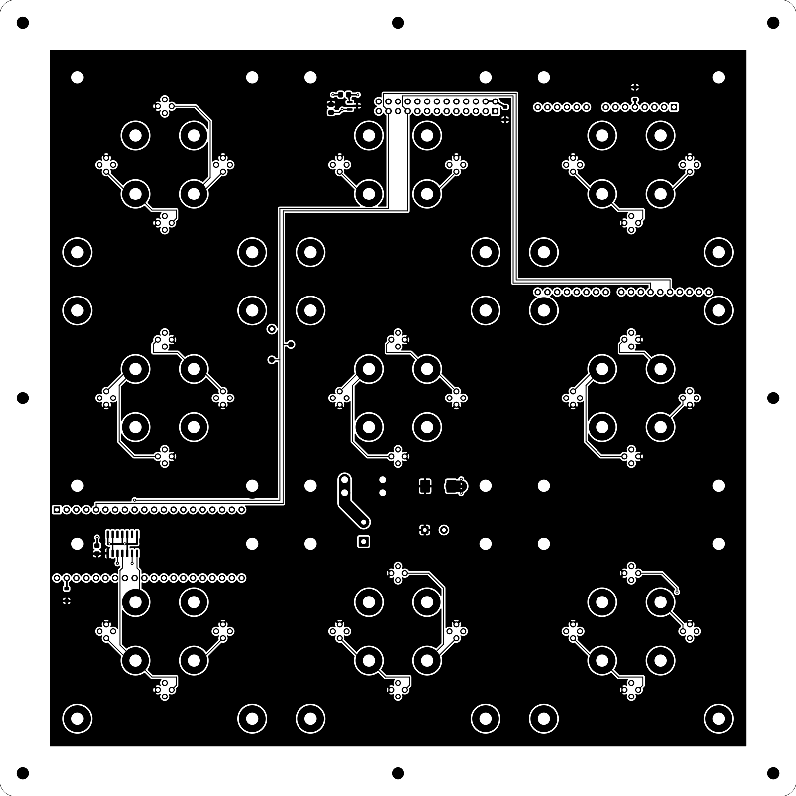
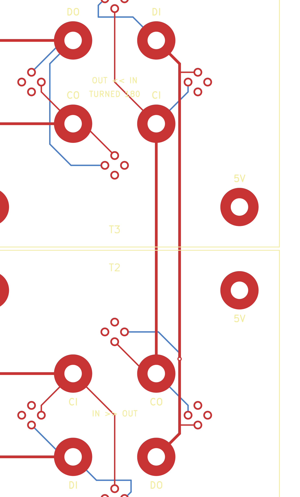
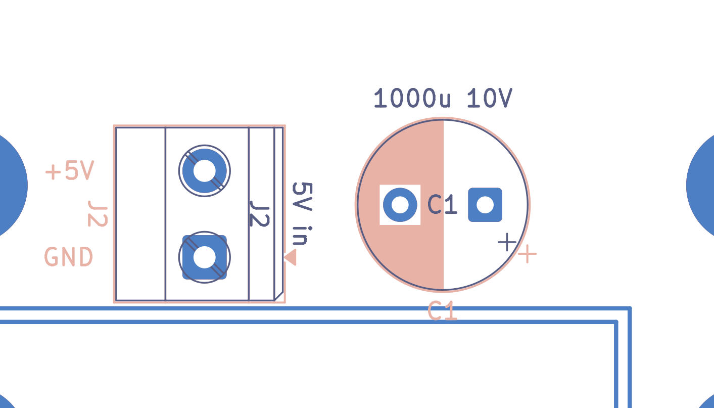
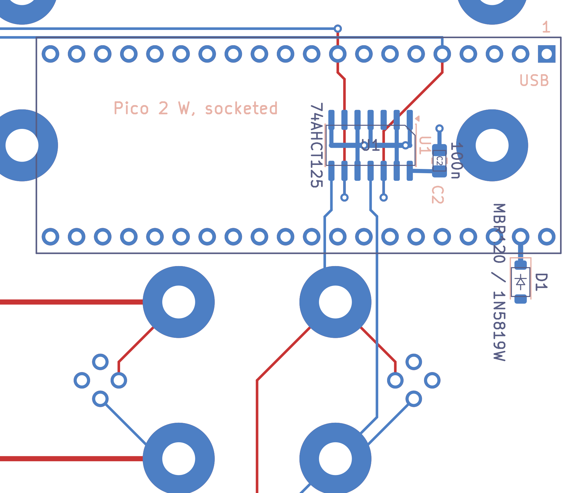
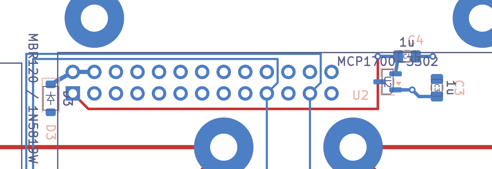
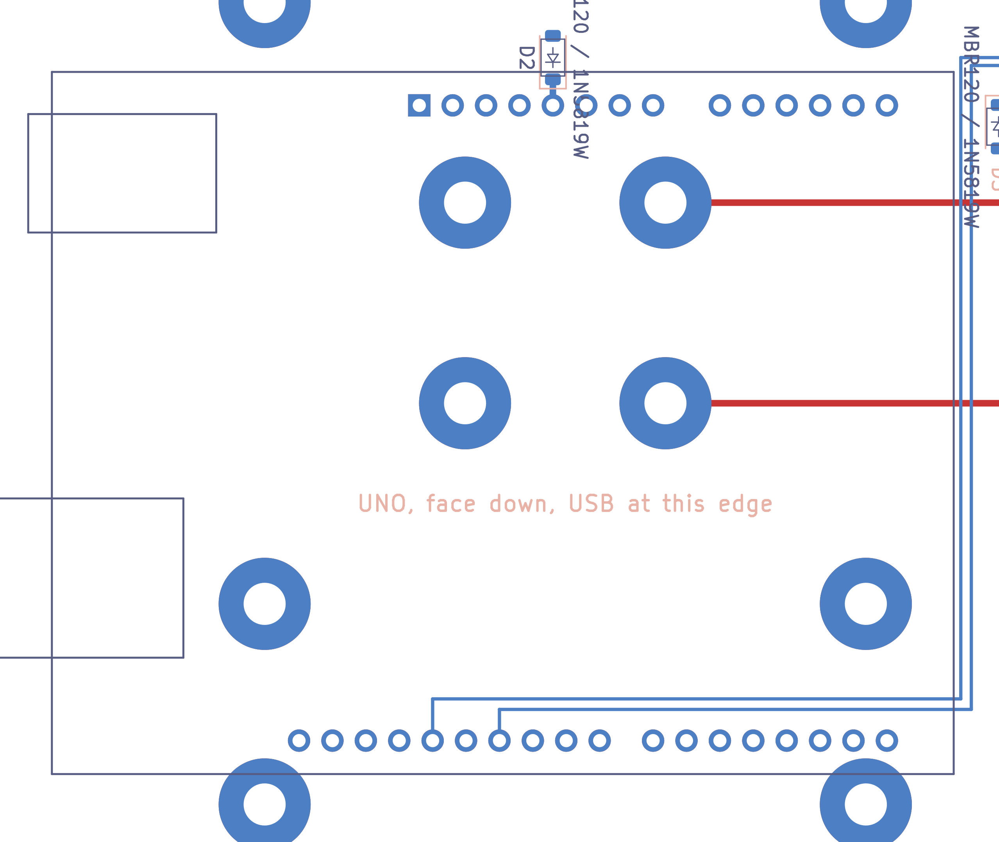

# ULTiM8x8 3x3 carrier board

A 208 x 208 mm, 2-layer backplane that holds nine [ULTiM8x8](https://github.com/wyolum/ultim8x8) APA102 tiles in a 3 x 3 grid (576 LEDs). The tiles bolt to it on M3 standoffs, and the standoffs carry 5 V, GND, clock and data. It replaces a 3D-printed backplane with copper-tape tracks in Justin's light box.

**Status: draft for review, 2026-11-21. Not fabricated. Please do not order from this yet.**

Anool, this README is meant to be everything you need. The short version of what to look at is the [review checklist](#review-checklist).

## Read this first

1. **There is no schematic.** The board is generated by a Python script, `2026-11-21_build_carrier.py`, which places every pad and track and assigns the nets. KiCad's DRC passes with 0 violations and 0 unconnected pads ([report](docs/2026-11-21_drc_report.txt)), but that only proves the copper matches the nets the script assigned. It does not prove those nets are the right circuit. The intended circuit is the [netlist](#netlist) below.
2. **The script and this README were written by an AI assistant (Claude) working with Justin.** "I" below is the assistant. Nobody who knows KiCad well has looked at the result. Treat everything as unverified.
3. **The tile, Pico, UNO and Pi-header footprints are drawn in the script**, not taken from a library. J2, C1 to C4, D1 to D3, U1 and U2 are stock KiCad library footprints.
4. **The .kicad_pcb is generated output.** Edits made in KiCad are overwritten the next time the script runs. If you would rather fix things by hand, say so and the script gets retired.

## Files

| File | What it is |
|---|---|
| `ultim_carrier.kicad_pcb`, `ultim_carrier.kicad_pro` | The board, KiCad 10.0.3, pours filled |
| `2026-11-21_build_carrier.py` | Generator. All dimensions and nets are near the top. |
| `2026-11-21_plot_carrier.py` | Draws the tile-terminal check picture from the saved board |
| `2026-11-21_render_docs.py` | Renders the images in `docs/` |
| `docs/2026-11-21_drc_report.txt` | DRC report for the committed board |

To rebuild from scratch on macOS with KiCad 10:

```bash
KP=/Applications/KiCad/KiCad.app/Contents/Frameworks/Python.framework/Versions/Current/bin/python3
KC=/Applications/KiCad/KiCad.app/Contents/MacOS/kicad-cli
$KP 2026-11-21_build_carrier.py ultim_carrier.kicad_pcb pads.json
$KC pcb drc --refill-zones --save-board --severity-all -o docs/2026-11-21_drc_report.txt ultim_carrier.kicad_pcb
python3 2026-11-21_plot_carrier.py pads.json docs/2026-11-21_tile_nets.png
python3 2026-11-21_render_docs.py
```

The script saves the pours unfilled, because filling zones from KiCad 10's Python crashes without a GUI. The `drc --refill-zones --save-board` step fills them.

## How the pictures are oriented

- **LED-side view** means looking at the finished box from the front, through the tiles. The front copper (F.Cu) faces the tiles.
- **Back view** means the board as you hold it to solder the parts. It is the LED-side view mirrored left to right.
- In the color pictures the pours are hidden so the traces show: **red is F.Cu, blue is B.Cu**.
- Coordinates in this README and in the script are millimeters from the board center, x right and y up in the LED-side view.

## What is on the board



*Back view. UNO at left, AlaMode header top center, Pico lower right, supply terminal and bulk capacitor above the Pico.*

- **Tiles:** 9 footprints, T0 to T8, 8 plated M3 holes each. Signal enters at T0 (lower left in the LED-side view), runs along the bottom row, back along the middle row, then along the top row. The middle row of tiles is mounted turned 180 degrees so the hops between rows stay short.
- **Power:** GND pour on F.Cu, +5V pour on B.Cu. Supply comes in on J2 with C1 across it.
- **Controllers:** three alternatives on the same clock and data lines. Fit only one.
- **Level shifter:** U1, 74AHCT125, between the controllers and the first tile.

## Netlist

| Net | Connects |
|---|---|
| `+5V` | J2 pin 2, C1 +, every tile 5V hole (18), U1 pin 14, C2, C3, U2 VIN, anodes of D1, D2, D3. B.Cu pour. |
| `GND` | J2 pin 1, C1 -, every tile GND hole (18), U1 pins 1, 2, 4, 7, 9, 10, 13, C2, C3, C4, U2 GND, Pico pins 3, 8, 13, 18, 23, 28, 38, UNO GND x3, Pi header pins 6, 14, 20, 25. F.Cu pour. |
| `CLK_IN` | Pico pin 4 (GP2), UNO D13, Pi header pin 23, U1 pin 5 |
| `DAT_IN` | Pico pin 5 (GP3), UNO D11, Pi header pin 19, U1 pin 12 |
| `CLK0` | U1 pin 6, T0 clock in |
| `DAT0` | U1 pin 11, T0 data in |
| `CLK1` to `CLK8`, `DAT1` to `DAT8` | Tile n-1 out to tile n in |
| `CLK9`, `DAT9` | T8 outputs, unconnected |
| `VSYS` | D1 cathode, Pico pin 39 |
| `UNO_5V` | D2 cathode, UNO 5V pin |
| `ALA_5V` | D3 cathode, Pi header pins 2 and 4 |
| `ALA_3V3` | U2 VOUT, C4, Pi header pin 1 |

U1 gate use: gate 2 (pins 5 in, 6 out, 4 enable) buffers the clock and gate 4 (pins 12 in, 11 out, 13 enable) buffers the data. Gates 1 and 3 are parked with inputs and enables grounded; pins 3 and 8 are open. To run without U1, bridge pins 5-6 and 11-12 with solder.

## Parts

| Ref | Part | Footprint |
|---|---|---|
| J2 | 2-pin screw terminal, 5.08 mm | Phoenix MKDS 1,5/2-5.08 |
| C1 | 1000 uF 10 V electrolytic, under 20 mm tall | Radial D10 P5 |
| U1 | 74AHCT125 | SOIC-14 |
| C2 | 100 nF | 0805 |
| D1, D2, D3 | 1 A Schottky, MBR120 or 1N5819W | SOD-123 |
| U2 | MCP1700-3302 | SOT-23 |
| C3, C4 | 1 uF | 0805 |
| A1 | Pico 2 W on two 1x20 sockets | drawn in script |
| A2 | Arduino UNO on male headers, face down | drawn in script |
| J3 | 2x13 male header, 2.54 mm, Pi P1 pinout | drawn in script |

## Review checklist

Each item says what was intended and what I am least sure of.

### 1. Tile terminal holes and nets

The tiles Justin has are an older revision with 8 terminal holes: an outer square at +/-22.86 mm (5V on the two top corners, GND on the two bottom) and an inner square at +/-7.62 mm (clock in, clock out, data in, data out). The v2 layout in the ultim8x8 repo has 16 holes; these 8 are a subset of them with the same nets, so the board should fit both revisions.



*The tile in hand, seen from the back. Flip it left to right to compare with the LED-side pictures.*



*Every tile pad read back from the saved board, LED-side view. Arrows join a tile's outputs to the next tile's inputs.*

Please check:
- Hole positions and nets against a real tile or the tile layout. A first, 3D-printed version of this backplane was scrapped because it was routed for the 16-hole tile and not the 8-hole one.
- Pad size. Holes are 3.2 mm with a 7.0 mm pad on both sides, meant to seat a 5.5 mm hex standoff (6.35 mm across corners) on the front and a screw head on the back.
- Whether a plated M3 hole with a standoff and screw is a sound way to carry up to about 3.8 A per tile at full white (64 LEDs at 60 mA).

### 2. Power pours



*F.Cu, filled, LED-side view: GND pour plus the clock and data traces.*



*B.Cu, filled, seen through from the LED side: +5V pour.*

Please check:
- **Pour pullback.** Both pours stop 1 mm inside the 184 mm frame opening, so 13 mm of bare board runs around the edge. This is deliberate: the frame wall and the eight perimeter screws sit there, and the corner screws run through to metal standoffs at the front of the box.
- **Solid pad connections.** Tile power pads and J2 connect to the pours without thermal spokes, since they carry current and the tile pads are never soldered. Soldered parts in the pours (C1, C2, C3, D1 to D3 anodes, U1 pin 14, U2 VIN, header ground pins) use spokes 0.6 mm wide with a 0.4 mm gap.
- **Pour clearance** is 0.4 mm and minimum width 0.25 mm.
- The eight perimeter holes are unplated, 3.2 mm.

### 3. Tile-to-tile signal traces



*Front, LED-side view, right-hand side: the hop from the bottom row up to the middle row.*

Clock and data run on F.Cu, 0.5 mm wide. Along a row each hop is a straight 45.7 mm trace. At a row turn both hops share one column of holes, so the longer one steps 7.62 mm outward around the other's pads.

Please check:
- Whether 0.5 mm traces across a ground pour are reasonable for APA102 clock and data, and whether you would add series resistors.

### 4. Supply entry



*Back view. J2 pin 1 (square) is GND, pin 2 is +5V. C1's square pad is +.*

Please check:
- J2 polarity and silkscreen, and that a 2-pin 5.08 mm terminal is adequate. Full white on 576 LEDs is nominally 34 A, which this entry cannot carry; the box is meant to run far below that, limited in firmware. There is no fuse.
- C1 polarity.

### 5. Pico 2 W, level shifter and D1



*Back view. USB end of the Pico is at the right. U1 sits under the Pico between its pin rows.*

Please check:
- **U1 pinout and gate wiring** against the 74AHCT125 datasheet. This is the part of the circuit most worth a careful look.
- **Pico pin numbering and orientation.** The Pico's top faces away from the board, pin 1 at the square pad.
- **D1 direction:** anode on +5V, cathode on VSYS (pin 39), so a USB cable cannot power the LED rail.
- **The +5V feed to U1 pin 14 and C2.** The Pico's pin rows and U1 wall that corner off from the pour, so a 0.3 mm track brings +5V in between Pico pins 38 and 39.
- **Traces between header pins.** Two 0.25 mm traces pass between adjacent 2.54 mm pins with about 0.3 mm clearance.
- The data input reaches U1 on F.Cu, passing under the chip to a via.
- Mechanical: two tile standoff screw heads sit under the Pico, which is why it goes on sockets and is not soldered flat.

### 6. AlaMode on a Pi-style header



*Back view, which is the AlaMode's top view. Pin 1 is the square pad, lower left.*

The AlaMode plugs onto J3 as it would onto a Raspberry Pi. Its ATmega's SCK and MOSI reach the Pi socket only through its TXS0108 translator (U6 on the AlaMode v3 schematic), whose Pi side is powered from P1 pin 1. So this board supplies 3.3 V on pin 1 from U2, and takes clock from pin 23 and data from pin 19 at 3.3 V.

Please check:
- **That this reading of the AlaMode is right.** I took it from `aLaMode_v3.net` in the alamode repo. You designed that board and I did not.
- That the AlaMode's 5V_LINK jumper is how 5 V on P1 pin 2 reaches its rail, and that feeding it through D3 (about 4.7 V) is acceptable.
- U2 pinout (MCP1700 in SOT-23: 1 GND, 2 VOUT, 3 VIN) and the 3.3 V trace, which runs on F.Cu under the odd pin row.
- Pin 9, a ground on a real Pi, is left open because the 3.3 V trace boxes it in. The AlaMode does not connect it.
- A TXS0108 driving about 230 mm of trace into U1.

### 7. Arduino UNO, face down



*Back view. The boxes at the left are the UNO's USB-B and DC jack. Top row is the power and analog header, bottom row is digital.*

The UNO plugs face down onto male headers, like a shield in reverse. D13 is clock, D11 is data, and D2 feeds its 5V pin.

Please check:
- **Header geometry and handedness.** Pin positions are from the standard UNO R3 layout (rows 48.26 mm apart, the 160 mil offset in the digital row). Because the UNO is face down, a mirror-image mistake is easy to make here.
- **Connector overhang.** The USB-B and DC jack are about as tall as the gap between the boards, so the UNO is placed with both overhanging past the outermost tile screws. Its USB end is 4 mm inside the board edge and the USB shell sticks out about 2.4 mm. The case has to be open there. These positions are from memory of the UNO drawing, not measured.
- The UNO's ICSP headers come within about 1 mm of two tile screw heads on standard stacking height.
- Feeding the UNO through its 5V pin behind a diode.

### 8. Clock and data bus to the three controllers

Visible in the overview picture at the top. One pair of 0.25 mm traces on B.Cu runs from the Pico pins up to the Pi header and on to the UNO, following the lines midway between tile hole rows.

Please check:
- **Length.** About 230 mm from the Pico to the Pi header and about 350 mm to the UNO, unterminated, with the unused controllers' stubs always attached.
- Whether you would rather have a jumper or 0 ohm link per controller.
- The pair cuts across the +5V pour. DRC shows the pour still connected everywhere, but look for necks.

## Things that are not done

- No schematic, no Gerbers, no drill files, no BOM file.
- No fuse, no reverse-polarity protection, no test points.
- Front silkscreen has tile outlines and terminal labels only. No assembly notes, no "this row turned 180 degrees" marking.
- The enclosure will be redesigned around this board. Nothing here has been checked against a case in 3D.

## License

[CERN Open Hardware Licence v1.2](LICENSE), the same licence as [ULTiM8x8](https://github.com/wyolum/ultim8x8).
